# curo

> From Latin *curo*: "I care for, I heal."

[![Go Reference][reference-badge]][reference]
[![CI][ci-badge]][ci-workflow]
[![License][license-badge]](LICENSE)

Curo adds adaptive resilience to outbound calls in Go. It wraps an
`http.RoundTripper`, learns how each dependency behaves from bounded
observations of live traffic, and applies budgeted retries, dependency
breakers, and adaptive timeouts without static thresholds to tune. An
`Engine` applies the same controls to calls outside `net/http`, such as gRPC
calls and database queries.

> [!NOTE]
> Curo is `v0.x`. Releases follow the
> [compatibility policy](docs/adr/0010-versioning-and-compatibility.md), and a
> minor release may still make a breaking change, with migration notes in the
> [changelog](CHANGELOG.md).

## Features

- **Drop-in transport.** `curo.New` wraps any `http.RoundTripper`, and an
  `http.Client` uses the result like any other transport. Curo depends only
  on the standard library.
- **Any dependency.** `curo.NewEngine` brings the same controls to calls that
  do not go through `net/http`, which the application runs through
  `Engine.Do` and classifies itself. The separate
  [`curogrpc`](curogrpc/README.md) module does this for unary gRPC calls with
  one interceptor.
- **Safe rollout.** `Observe`, the default mode, reports what Curo would do
  without changing any request. `Enforce` applies the controls, `Off` passes
  requests straight through, and `SetMode` switches modes at runtime.
- **Budgeted retries.** A replay-safe read that fails with a transport error
  or a 502, 503, or 504 is retried at most once, within budgets that allow
  about one retry per ten requests.
- **Dependency breakers.** Once a dependency is diagnosed as down, requests
  to it fail fast with `ErrBreakerOpen` instead of waiting, and after each
  cooldown a probe request detects recovery.
- **Adaptive timeouts.** Reads get a timeout learned from the dependency's
  recent latency, within bounds you set, and Curo never extends a caller's
  deadline.
- **Explainable decisions.** `Stats` counts requests and actions, and
  `Report` shows each dependency's diagnosis with its evidence and reasons.
  Both encode to JSON.
- **Fail-safe by design.** A failure inside Curo never fails a request, and
  repeated failures make Curo pass requests straight through. Its state stays
  bounded however many hosts the application calls.

## Install

```sh
go get github.com/raj1kshtz/curo@latest
```

Curo requires Go 1.23 or later.

## Quick start

Wrap the base transport once, and share the client:

```go
transport, err := curo.New(http.DefaultTransport)
if err != nil {
    return err
}
client := &http.Client{Transport: transport, Timeout: time.Minute}

// Use client for every call, and call transport.Close() when the
// application shuts down.
```

The transport starts in `Observe`: it sends every request unchanged while it
learns how each dependency behaves. Once `Stats` and `Report` look right,
switch to `Enforce`, either at startup with `curo.WithMode(curo.Enforce)` or
at runtime:

```go
if err := transport.SetMode(curo.Enforce); err != nil {
    return err
}
```

Keep the client timeout above Curo's timeout ceiling, 30 seconds by default.
A read that Curo cuts counts as a dependency failure only when the cut
happens at the ceiling, so Curo's cuts can open a breaker only if callers
wait that long. The [operations guide](docs/guides/operations.md) explains
wiring, deadlines, timeout bounds, and rollout in detail.

## Handle errors

In `Enforce`, Curo can end a request with one of two errors. `http.Client`
wraps them in `*url.Error`, so match them with `errors.Is`:

```go
response, err := client.Do(request)
switch {
case errors.Is(err, curo.ErrBreakerOpen):
    // Not sent: the dependency is down, so use a fallback.
case errors.Is(err, curo.ErrTimeout):
    // Ended by Curo: the dependency may have received the request.
case errors.Is(err, context.DeadlineExceeded):
    // Another deadline or timeout expired, such as the caller's.
case err != nil:
    // Other errors are returned as the base transport reported them.
default:
    defer response.Body.Close()
    // Use the response.
}
```

`ErrTimeout` also matches `context.DeadlineExceeded`, so check it first.

## Monitor

`Stats` returns aggregate counters for requests, retries, breakers, timeouts,
and Curo's own failures. `Report` returns each dependency's latest decision:
its readiness, diagnosis, reasons, evidence, and adaptive timeout. Both
encode to JSON, so an internal debug endpoint can serve them:

```go
mux.HandleFunc("/debug/curo", func(w http.ResponseWriter, _ *http.Request) {
    w.Header().Set("Content-Type", "application/json")
    _ = json.NewEncoder(w).Encode(transport.Report())
})
```

A `Report` names the hosts that the application calls, so keep the endpoint
private.

## Other calls

An `Engine` applies the same controls to calls that do not go through
`net/http`, such as gRPC calls and database queries. Each call names its
dependency, says whether it is read-only or safe to repeat, and classifies
its errors:

```go
engine, err := curo.NewEngine()
if err != nil {
    return err
}

err = engine.Do(ctx, curo.Call{
    Classify: classify,
    Scheme:   "grpc",
    Host:     "inventory.internal",
    Port:     443,
    ReadOnly: true,
}, func(ctx context.Context) error {
    item, err = inventory.GetItem(ctx, request)
    return err
})
```

`Classify` tells Curo whether an error is a normal answer, the caller's
mistake, a rate limit, or a failure of the dependency. Without it, every
error counts against the dependency. In `Enforce`, `Do` returns
`curo.ErrBreakerOpen` without running the attempt while the dependency is
down, and `curo.ErrTimeout` when Curo ended a read-only attempt. The
[operations guide](docs/guides/operations.md#run-other-calls-through-an-engine)
explains how to classify errors and when a call may be retried.

For gRPC, the [`curogrpc`](curogrpc/README.md) module provides a unary client
interceptor that runs each call through an `Engine`. It names each target
from the channel, finds read-only methods in a list or in their protos, and
classifies status codes:

```go
interceptor, err := curogrpc.NewUnaryClientInterceptor(engine)
if err != nil {
    return err
}

conn, err := grpc.NewClient(target,
    grpc.WithTransportCredentials(creds),
    grpc.WithChainUnaryInterceptor(interceptor),
)
```

`curogrpc` is a separate module, so only applications that import it depend
on grpc-go:

```sh
go get github.com/raj1kshtz/curo/curogrpc@latest
```

## How it works



Curo tracks each dependency by scheme, host, port, and method class. For each
one it keeps a two-minute window of recent outcomes and a longer historical
baseline, and deterministic rules turn them into a diagnosis such as
`Transient` or `DependencyDown`. The diagnosis and latency evidence select the
controls that `Enforce` applies, and every decision lists the reasons behind
it.

The [behavior reference](docs/reference/behavior.md) describes each
mechanism, its fixed values, and its known limits. The
[engine design](docs/design/engine.md) explains why Curo works this way, and
the [architecture decisions](docs/adr/README.md) record the alternatives that
were rejected.

## Safety

Curo runs inside the application it protects, so its first rule is host
application inviolability:

- Curo-owned failures must not propagate into the host.
- The original request must not be mutated.
- An attempt with an unknown side effect must never be replayed blindly.
- State, concurrency, cardinality, and mitigation work must remain bounded.
- `Observe` is the default; behavior changes require explicit `Enforce`
  authority.
- The wrapped transport remains host-owned and keeps its existing panic
  semantics.

[ADR-0002](docs/adr/0002-host-application-inviolability.md) records the full
contract. `Stats` counts Curo's internal failures, and `curo.WithLogger` logs
them through `log/slog`, with the stage that failed and, for a panic, a stack
trace to include in a bug report.

## Scope

Curo is an embedded library for outbound calls, and its state belongs to one
process. A `Transport` wraps the base transport above the wire protocol, so
HTTP/1.1, HTTPS, and HTTP/2 need no Curo configuration, and tests run it over
each of them. The operations guide explains how to
[set up the base transport](docs/guides/operations.md#set-up-the-base-transport),
including HTTP/2 health checks. Apart from the timeout bounds, every
threshold is fixed and tuned from evidence.

Curo does not provide sidecars, a control plane, SDKs for other languages,
ingress middleware, or machine-learning policy. It covers calls that do not
go through `net/http`, such as database queries or cache commands, only when
the application runs them through an `Engine`, or through `curogrpc` for
unary gRPC calls, and it does not cover streams or long-lived connections.
The operations guide lists the
[known limitations](docs/guides/operations.md#known-limitations).

## Documentation

| Document | Contents |
| --- | --- |
| [Package documentation](https://pkg.go.dev/github.com/raj1kshtz/curo) | API reference and runnable examples |
| [curogrpc](curogrpc/README.md) | The gRPC client interceptor module: setup, targets, read-only methods, status codes, and limits |
| [Operations guide](docs/guides/operations.md) | Wiring, HTTPS and HTTP/2, other calls through an `Engine`, deadlines, timeout bounds, rollout, monitoring, error handling, and incident behavior |
| [Behavior reference](docs/reference/behavior.md) | How each mechanism behaves, its fixed values, and its known limits |
| [Engine design](docs/design/engine.md) | Runtime architecture, safety boundaries, state ownership, and mitigation design |
| [Architecture decisions](docs/adr/README.md) | Accepted decisions and the alternatives considered |
| [Changelog](CHANGELOG.md) | Changes in each release |

The [documentation index](docs/README.md) also links project governance.

## Compatibility

Curo follows [Semantic Versioning](https://semver.org/).
[ADR-0010](docs/adr/0010-versioning-and-compatibility.md) defines what a
release promises: the exported API and its documented behavior, `errors.Is`
identities, and the names and JSON encodings of modes and reports. Adaptive
tuning may improve in any minor release. Curo supports Go 1.23 and later, and
CI tests Go 1.23 and the two most recent Go releases. `curogrpc` has its own
versions, tagged `curogrpc/vX.Y.Z`, and requires Go 1.26 or later.

## Contributing

Feedback and contributions are welcome, especially on failure semantics,
replay safety, and bounded concurrency. Read
[CONTRIBUTING.md](.github/CONTRIBUTING.md) before opening a pull request.
Changes to an accepted decision start with an ADR.

## Security

Report vulnerabilities privately, as [SECURITY.md](.github/SECURITY.md)
describes.

## License

[Apache License 2.0](LICENSE).

[reference-badge]: https://pkg.go.dev/badge/github.com/raj1kshtz/curo.svg
[reference]: https://pkg.go.dev/github.com/raj1kshtz/curo
[ci-badge]: https://github.com/raj1kshtz/curo/actions/workflows/ci.yml/badge.svg
[ci-workflow]: https://github.com/raj1kshtz/curo/actions/workflows/ci.yml
[license-badge]: https://img.shields.io/badge/license-Apache--2.0-blue.svg
